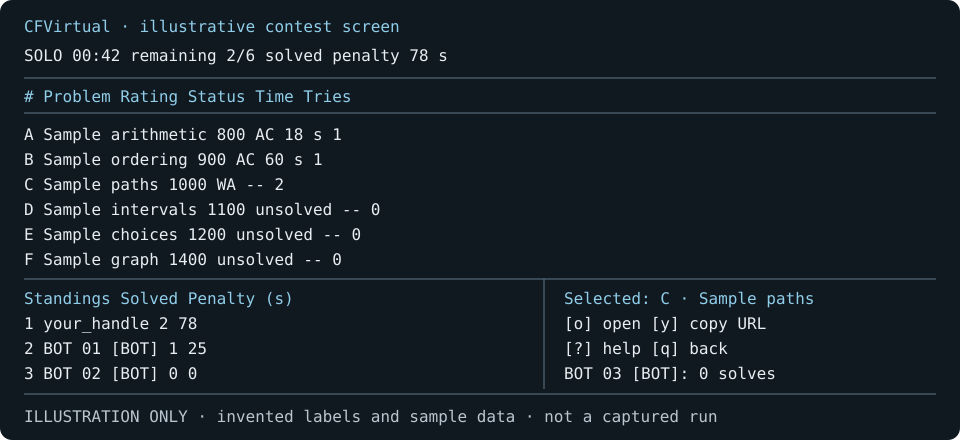

# CFVirtual

Run a personalized Codeforces practice contest in your terminal, with automatic scoring, fictional opponents, and multiplayer rooms.

> **Animated recording placeholder:** record `cfvirtual demo --seed 42` and add a short terminal animation here. No recording is bundled yet; see [the recording guide](docs/DEMO.md).

## Features

- Select unsolved problems near your rating, weighted toward weak tags in your public submission history.
- Run timed solo contests or authoritative WebSocket rooms with spectators and reconnect support.
- Follow ICPC-style standings, detected submissions, and clearly marked synthetic bots.
- Keep local SQLite history, export reproducible Markdown reviews, and revisit a spaced review queue.
- Use keyboard controls, blind problem metadata, themes, ASCII rendering, and JSON output.
- Try an offline six-problem, three-bot demo with a 90-second interactive clock.



*Illustration only: invented problem labels and sample standings, not a screenshot or evidence of a completed live contest.*

## Install

### Prebuilt binary

**Release setup is provided, but published binaries are not assumed to exist.** This checkout has no upstream remote. Replace `<repository-url>` with the actual repository URL in the commands below; it is a placeholder, not a download location.

Once maintainers publish a tag, download the matching archive and its `.sha256` file from that repository's Releases page:

| Platform | Release target | Archive |
|---|---|---|
| Linux, x86-64 glibc | `x86_64-unknown-linux-gnu` | `.tar.gz` |
| Linux, x86-64 musl | `x86_64-unknown-linux-musl` | `.tar.gz` |
| macOS, Intel | `x86_64-apple-darwin` | `.tar.gz` |
| macOS, Apple Silicon | `aarch64-apple-darwin` | `.tar.gz` |
| Windows, x86-64 | `x86_64-pc-windows-msvc` | `.zip` |

Names follow `cfvirtual-<tag>-<target>.<archive-extension>`. Verify the checksum before extracting (`sha256sum -c <archive>.sha256` on Linux, `shasum -a 256 -c <archive>.sha256` on macOS). On Windows, compare `Get-FileHash <archive> -Algorithm SHA256` with the checksum file. Put `cfvirtual` or `cfvirtual.exe` on your `PATH`.

### Cargo / source

Use Rust **1.99.1**, pinned in `rust-toolchain.toml`, and a C compiler/linker: SQLite is bundled and compiled from source. Linux needs the usual build tools; macOS needs Xcode Command Line Tools; Windows needs the MSVC C++ build tools. HTTPS uses rustls, so OpenSSL development headers are unnecessary. The locked Linux clipboard backend uses pure-Rust `x11rb`, without a `libxcb` build-time link dependency.

```sh
cargo +1.99.1 install --locked --git '<repository-url>' cfvirtual
```

For a local build, run these from a checkout:

```sh
cargo build --locked --release
cargo run --locked -- demo --seed 42
```

To install the binary as `cfvirtual` in a user-local PATH directory:

```sh
cargo install --locked --path . --root "$HOME/.local"
```

If `cfvirtual` is not found afterward, add `"$HOME/.local/bin"` to your shell's `PATH`.

### Arch Linux / AUR

[`packaging/PKGBUILD`](packaging/PKGBUILD) is a **source-package template**, not a claim that an AUR package has been published. Set `CFVIRTUAL_REPOSITORY_URL`, `CFVIRTUAL_SOURCE_URL`, and `CFVIRTUAL_SOURCE_SHA256` to the real repository, versioned source archive, and SHA-256 digest before running `makepkg -si` from `packaging/`. The archive must extract to `cfvirtual-0.1.0/`; update the version and directory together for a release. Replace the placeholders with fixed metadata and generate `.SRCINFO` before submitting to AUR.

## Quick start

Try the offline demo first:

```sh
cfvirtual
```

The bare command is a convenience alias for the offline demo with seed `42`.
The explicit form is equivalent and allows a different seed:

```sh
cfvirtual demo --seed 42
```

For a real contest, replace `your_handle` with your public Codeforces handle. Submit solutions manually in your browser; no Codeforces credentials are requested.

```sh
cfvirtual start --handle your_handle --problems 5 --duration 120 --bots 4
cfvirtual start --handle your_handle --tags dp,greedy --rating 1400 --refresh --reveal
```

`--duration` is in minutes. Solo defaults are five problems, 120 minutes, and four bots. `--refresh` requests a fresh problemset cache; `--blind` hides ratings/tags and `--reveal` allows revealing metadata. Room contests default to blind mode and zero bots.

Create a room and press `Enter` in its lobby to start:

```sh
cfvirtual room create --handle your_handle --listen 0.0.0.0 --port 7331 --bots 3
cfvirtual join --server 'ws://<lan-host>:7331' --code '<room-code>' --handle your_handle
cfvirtual join --server 'ws://<lan-host>:7331' --code '<room-code>' --handle your_handle --spectate
```

`<lan-host>` and `<room-code>` are placeholders; use the host's reachable address and the code shown in the lobby. Host settings determine the shared problem set. To create a room on an existing headless server, use `cfvirtual room create --server 'wss://<server-host>' --handle your_handle`.

| Key | Action |
|---|---|
| `j` / `k`, arrows | Select a problem or row |
| `o` / `s` | Open the selected problem page; submission remains manual |
| `y` | Copy the selected URL |
| `Tab`, `Enter` | Change pane / confirm the current action |
| `b` | Reveal metadata when permitted or after the contest |
| `p` | Solo pause overlay; **the clock continues** |
| `e` | Export a Markdown review from results |
| `r` | Retry connection; on saved solo results, queue unsolved problems |
| `v` | Queue unsolved problems from saved results, including room results |
| `x` | Host: end a running room early, with confirmation |
| `?`, `q` | Help / back or quit with confirmation where needed |

Use a terminal of at least 80×24. Global `--ascii` and `--theme <theme>` (including `default` and `colorblind`) work with every command. `--json` is supported by read commands and the headless `start`/`demo` flows; room, join, and serve remain interactive/network commands. Consult `cfvirtual --help` for command-specific options.

```sh
cfvirtual config set handle your_handle
cfvirtual config get handle
cfvirtual history --limit 10 --json
cfvirtual history --export '<contest-id>' --handle your_handle
cfvirtual review --due --limit 10
cfvirtual review --solve '<problem-key>'
cfvirtual review --skip '<problem-key>'
cfvirtual stats --json
cfvirtual --ascii --theme default demo --seed 42
```

Obtain `<contest-id>` from history and `<problem-key>` from the review queue (the Codeforces contest number followed by its problem index, not a local slot letter). `--solve` advances a review's interval through 1, 3, 7, 14, and 30 days; `--skip` resets it to one day. These are manual review outcomes, not submissions to Codeforces.

Configuration lives under `${XDG_CONFIG_HOME:-$HOME/.config}/cfvirtual/config.toml`; data under `${XDG_DATA_HOME:-$HOME/.local/share}/cfvirtual/` on Linux. Other platforms use their platform config/data directories. The data directory contains `cfvirtual.db` and `problemset.json`. Public handles and results are local data; passwords and session tokens are not saved in contest exports.

### JSON for scripts

Read commands emit only JSON on stdout with `--json`; diagnostics go to stderr. `history --json` is an array of records with `id`, `mode`, `started_at`, `problem_count`, `solved`, `penalty`, and `host_handle`. `review --json` is an array with problem identity/link metadata and `added_at`, `due_at`, `interval_days`, `ease`, and `lapses`. `stats --json` is an object with totals, `solve_rate`, `average_penalty`, `current_streak`, and `per_tag` entries (`problems`, `solved`, `solve_rate`).

Times are Unix seconds or elapsed seconds; penalties are seconds; solve rates are fractions, not percentages. These are local saved-contest statistics, not a replacement for the live public-history weakness profile. Consumers should tolerate additional fields. The room wire schema is separately documented in [PROTOCOL.md](docs/PROTOCOL.md).

## Scoring, bots, and detection

**Scoring.** A selected problem counts at its first `OK` submission created within the inclusive contest window, under a participating handle. Penalty is elapsed seconds to acceptance plus **1,200 seconds per rejected attempt before that acceptance**. Pending, skipped, and compilation-error submissions do not add attempts or penalty; unsolved problems and submissions after acceptance add no penalty. Order is solved count descending, penalty ascending, last acceptance ascending, then case-insensitive name. Handles match case-insensitively.

**Detection.** Only the read-only public `problemset.problems`, `user.info`, and `user.status` APIs are used. History analysis reads up to 10,000 recent submissions; contest polling reads the most recent 100 per handle, nominally every 20 seconds. One process-wide limiter spaces API requests by at least two seconds; larger rooms, slow responses, and backoff increase latency. Problemsets cache for 24 hours, with stale-cache fallback on API failure. If solo history cannot be fetched, selection uses uniform weights and cannot reliably exclude previously solved problems. Rooms require public profile validation.

The host/server owns room time and scores. At the cutoff, rooms drain two more polling passes for verdicts on in-window submissions, bounded to 180 seconds after any in-flight request. A later verdict can still be missed; a submission created after the cutoff never counts.

**Bots.** Opponents are fictional, visibly marked `BOT` (or `is_bot: true` in structured output), and generated locally from the seed. Their precomputed solve schedules depend on rating difference, with log-normal solve-time spread `sigma = 0.45` and occasional rejected attempts. They do not react to humans or represent real people. Names are unique within a generated set; no global Codeforces-name uniqueness is promised.

## Hosting

For LAN play, the embedded host's default port is 7331. Binding `0.0.0.0` exposes that port on available interfaces; participants connect to the host's reachable LAN address, not `0.0.0.0`.

```sh
cfvirtual serve --listen 127.0.0.1:7331
cfvirtual room create --server ws://127.0.0.1:7331 --handle your_handle
```

For remote access, keep the listener on loopback and terminate TLS in a reverse proxy or tunnel. `--public-url` advertises an address; it does not provision a tunnel, open a firewall, or enable TLS. See [SELF_HOSTING.md](docs/SELF_HOSTING.md) for LAN, reverse-proxy, and `cloudflared` examples.

## Limitations

- Read-only public API only: no login, password/API-key/cookie access, scraping, automated submission, local judging, or code execution.
- Rooms are trust-based. A valid public handle does not establish ownership; room codes are not authentication. Optional passwords are only an in-memory soft gate; use `wss://` across untrusted networks.
- API outages and polling delays affect detection. Cached solo practice is possible, but live acceptance detection still requires the API.
- Source-contest titles are unavailable in the problemset response/model. Nonstandard-contest exclusion uses problem names/tags and key/rating checks; it cannot guarantee title-based exclusion.
- Blind mode is a presentation aid, not anti-cheat. Problem links and public metadata remain accessible.
- Active rooms and reconnect sessions are in memory and do not survive a server restart. There is no hosted service or public matchmaking.
- The server limits each room to 32 players, eight spectators, and 16 bots. It retains at most 128 rooms until restart. Slow or oversized WebSocket messages can disconnect a client.
- Review exports report recorded elapsed acceptance times and attempts, not thinking time or invented time-on-task. Local stats use host results and UTC-date streaks.
- Clipboard/browser integration depends on the desktop session; over SSH or without a clipboard service, use the displayed problem URL.

## Contributing and license

Read [SPEC.md](SPEC.md), [DECISIONS.md](DECISIONS.md), and the [protocol](docs/PROTOCOL.md). Use the pinned toolchain and run:

```sh
cargo fmt --check
cargo clippy --all-targets -- -D warnings
cargo test --locked --offline
cargo build --locked --release
```

Fetch dependencies with `cargo fetch --locked` before offline tests. Tests use fixtures and local mock servers, without live Codeforces requests. CI checks Ubuntu, macOS, and Windows. Tag builds are release automation, not evidence that a release has already been published; see [CHANGELOG.md](CHANGELOG.md) for unreleased changes.

Contributions are welcome under the [MIT license](LICENSE). Use synthetic fixtures and `your_handle` in examples; keep credentials and personal or machine-specific data out of contributions.
